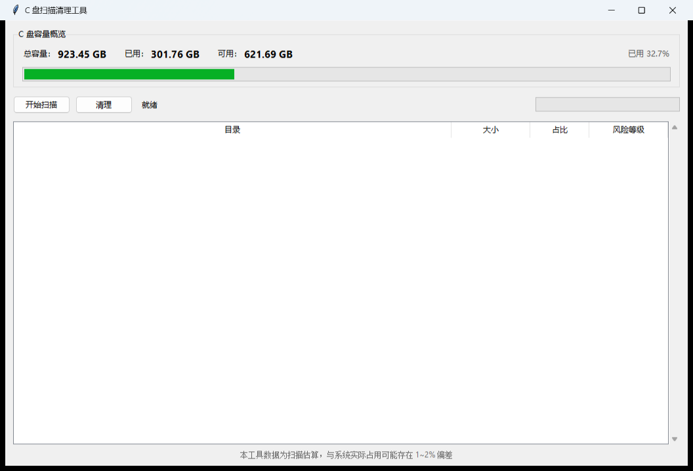
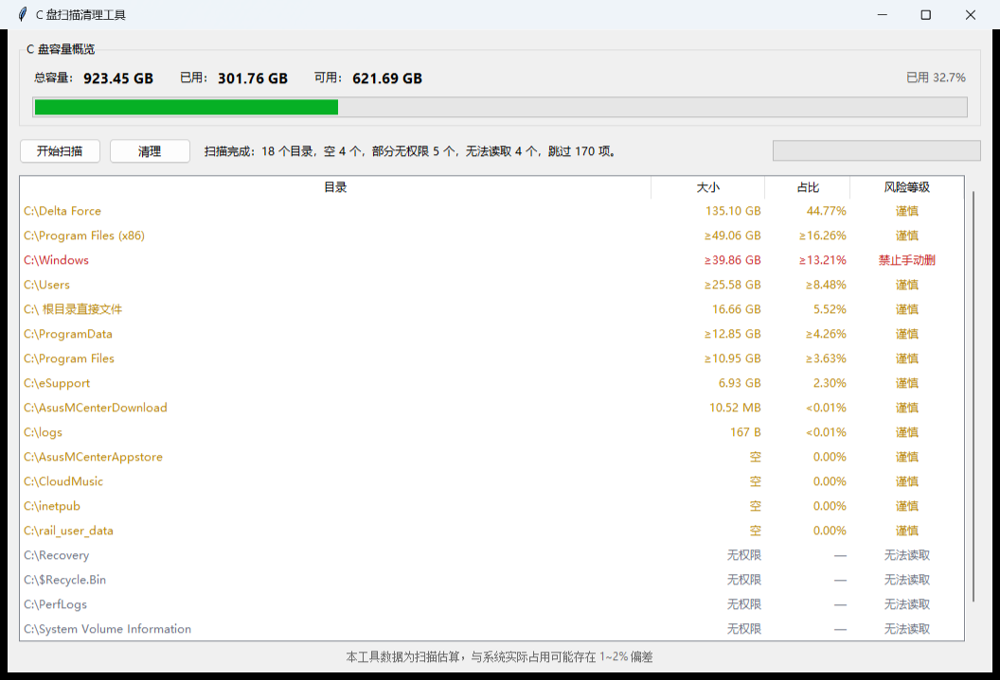
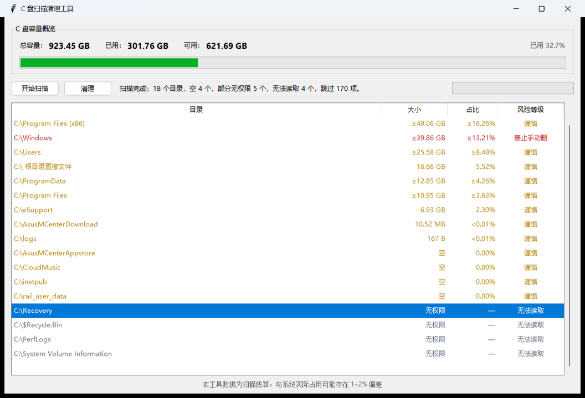
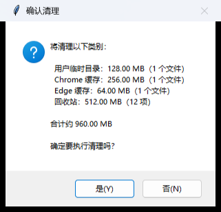

# C 盘空间医生

一个用三阶段扫描告诉你 C 盘空间到底被谁占用的 Windows 诊断工具。

## 这是什么，不是什么

- 是：告诉你 C 盘空间到底被谁占了的诊断工具。
- 不是：一键腾出 50GB 的清理神器。

需要诚实说明：真实可清理量通常只有 1~2 GB，真正的大头是游戏和系统文件。它们只能转移，不能随便删除；删错了反而会让系统或程序无法正常工作。

## 快速开始

- 环境：Windows + Python 3（需要 Tkinter）
- 依赖：`pip install Send2Trash`
- 启动：`python gui.py`（命令行版本为 `python scan.py`，默认只读）

## 工作原理：三阶段扫描

1. **浅层扫描找候选**：先用限制层数的浅层扫描快速摸清 C 盘一级目录，按大小排出最值得继续看的候选。
2. **对候选完整递归**：对候选目录做不限深度的完整递归，避免浅层扫描漏掉深层文件。
3. **补全所有一级目录后与磁盘已用对照**：补全所有一级目录的完整大小，再加上 `C:\` 根目录直接文件，最后与 `shutil.disk_usage` 的“已用”做对照。

最终表格使用完整递归结果，而不是浅层估算。扫描统计的是文件逻辑大小，磁盘“已用”还包含 NTFS 元数据、系统保留空间和簇分配开销，两者口径不同，所以需要对照而不是直接相等。

## 开发过程中踩过的坑

### 1. 只扫 3 层，`C:\Users` 被严重低估

**现象**：第一版只扫 3 层，`C:\Users` 算出 44 MB，真实是 24.46 GB，低估约 500 倍。

**原因**：浅层扫描有 `max_depth`，深层文件没有计入；一级目录的浅层合计不能代表完整占用。

**怎么修的**：保留浅层扫描只做候选发现，对候选再做 `full_scan` 完整递归；最后补全所有一级目录，表格和磁盘对照都使用完整递归结果。深度限制不再作为最终大小。

### 2. WinSxS 的 18 GB 是硬链接造成的表观虚高

**现象**：WinSxS 显示 18 GB，看起来像可以大删一笔。

**原因**：NTFS 硬链接让同一个文件被多个路径重复统计，按路径累加会虚高；重解析点虽然被跳过，但硬链接仍然会被重复计数。

**怎么修的**：不把 WinSxS 当普通可删目录，风险等级标为“禁止手动删”，并提示使用 DISM 组件清理或系统存储设置处理，不提供手动删除入口。

### 3. 风险分级顺序写反，`C:\Windows\Temp` 被判成“安全”

**现象**：`C:\Windows\Temp` 被标成“安全”，看起来可以放心删。

**原因**：风险分类先判断目录名是否在 `SAFE_DIR_NAMES`（`temp`、`cache` 等）里，没有先检查禁止前缀；顺序写反后，系统目录先命中了“安全”。

**怎么修的**：调整 `classify_risk` 的判断顺序：先判断 `C:\` 根目录和 `FORBIDDEN_PREFIXES`，再判断安全目录名，最后才是“谨慎”。这样 `C:\Windows\Temp` 仍然归入“禁止手动删”。

### 4. 确认机制被管道传入的 yes 绕过

**现象**：脚本里用管道把 `yes` 传给清理命令，可以绕过交互确认，一键执行清空。

**原因**：确认只读取 `stdin` 中的文本，没有判断 `stdin` 是不是真实终端；管道输入让 `yes` 直接通过。

**怎么修的**：在真正清理入口和 `main()` 早期加入 `sys.stdin.isatty()` 检查。不是真实终端就直接拒绝执行并打印原因，`--dry-run` 仍然可用；是真实终端才进入 `yes` 确认流程。清理操作不再接受管道输入。

### 5. 26 个文件删除失败

**现象**：清理时出现 26 个文件删除失败，报错包括 WinError 32（文件被占用）和 WinError 161（短路径/路径无效）。

**原因**：临时文件和缓存经常被浏览器、编辑器或其他程序占用；部分路径是短路径或已经失效。逐文件强制删除会让整个清理流程中断。

**怎么修的**：每个文件单独 `try/except`，失败计数后继续处理后面的文件，最后汇总成功数和失败数。不强行结束进程，也不绕过系统保护；提示用户关闭相关程序后重试。

### 6. “0.00 MB”把“空目录”和“没权限”混为一谈

**现象**：`C:\Recovery`、`C:\System Volume Information`、`C:\inetpub` 等行显示 0.00 MB，用户会以为这些目录是空的、不用管。

**原因**：扫描对空目录和读取失败都返回 0；`format_size` 对小于 0.01 MB 的非零大小也会四舍五入成 0.00 MB；表格没有区分这两种状态。

**怎么修的**：扫描结果区分“有大小 / 空 / 无权限”，另外对“大目录里有少量条目读不到”的情况显示为 `≥ 大小`。空目录显示“空”；完全读不到显示“无权限”、占比“—”、风险“无法读取”，并排到表格最后；小尺寸改用 B/KB 显示，不再出现非零却显示 0.00 MB 的情况。实测 `C:\Recovery` 和 `C:\System Volume Information` 无法完整读取，而 `C:\inetpub` 在这台机器上确实为空，所以显示“空”。

### 7. 自动化截图误触发了真实清理

**现象**：给 README 自动截图时，清理确认框没有被取消，最终以“是”返回，真实清理被执行了一次。回收站被清空，清空回收站释放的量约为 1.65 GB；一个 53 B 的 `.ses` 临时文件被移入回收站。系统目录没有被删除，但之前回收站里的内容无法通过普通方式恢复。

**原因**：截图脚本用 `WM_CLOSE` 关闭确认框，没有显式选择“否”，也没有在继续之前校验返回值；演示环境直接调用了真实的确认和清理链路，清理函数拥有真实文件系统权限。“窗口已关闭”被错误地当成了“操作已取消”。

**怎么修的**：截图脚本改为向确认框发送 `WM_COMMAND IDNO`（否），等待 `dialog_closed`，并确认返回值为 `False`；演示环境把 `execute_clean_plan` 替换为 no-op，即使误点“是”也不会执行删除；截图使用代表性数据，不再触碰真实清理。

**由此定下的规则**：任何可能触发不可逆操作的自动化测试，必须在破坏性函数边界做 no-op 或沙箱隔离；必须按控件 ID 显式选择安全分支，不能靠关闭窗口；必须校验返回值后才能继续。“窗口关闭”不等于“操作取消”。

## 安全设计

- **白名单**：只处理用户临时目录、浏览器缓存等白名单根目录；回收站走系统接口；重解析点拒绝处理；文件路径必须落在白名单内。
- **删除到回收站**：文件通过 Send2Trash 移入回收站，不直接 `unlink`；回收站清空使用系统 API，清空后不可逆。
- **清理前二次确认**：CLI 必须处于交互式终端并输入 `yes`；GUI 弹窗列出清理类别和总大小，用户点确定才执行。非交互式调用直接拒绝。
- **不可逆操作提示**：明确提示回收站清空不可恢复，移入回收站的文件需要再次清空才真正释放；风险列标出“禁止手动删”和“无法读取”。

## 已知限制

- 硬链接会导致扫描估算与系统实际占用存在 1~2% 的偏差。
- 部分系统目录需要管理员权限才能扫描，当前显示为“无权限”。
- 仅支持 Windows。

## 许可证

MIT
