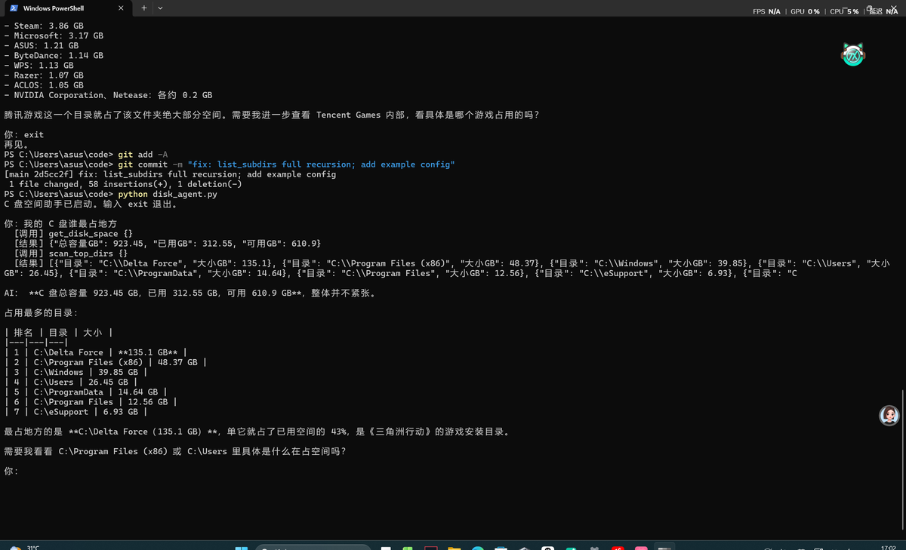

# C 盘空间医生

一个能对话的 Windows C 盘空间分析助手。



## 这是什么

- 两个入口：`disk_agent.py` 是命令行智能体（主交付），`gui.py` 是图形界面版
- 不是"一键腾出 50GB"的清理神器。真实可清理量只有 1~2 GB，
  真正的大头是游戏和系统文件，只能卸载或迁移

## 一、能运行

### 环境

Windows + Python 3.10 以上

### 安装

```bash
pip install -r requirements.txt
```

### 配置

1. 打开 https://platform.deepseek.com 注册并充值（10 元够用很久）
2. 创建 API Key
3. 复制 `config.example.py` 为 `config.py`
4. 把 `config.py` 里的 `API_KEY` 换成你自己的

### 运行

```bash
python disk_agent.py
```

然后可以这样对话：

```
你：我的 C 盘谁最占地方
你：那第二个呢
你：帮我看看还剩多少空间
你：exit
```

### 图形界面版

```bash
python gui.py
```

## 二、能讲清

### 它怎么工作（两层循环）

外层 `while True` 管对话：等你输入 → 把这句话加进 `messages` → 交给内层。

内层 `for` 管干活：把 `messages` 发给模型 → 模型要工具就执行、结果塞回 `messages`
→ 模型不要工具了就回答，返回外层继续等下一句。

### 上下文怎么管

`messages` 是列表，每轮把历史整个重发一遍（模型无状态，不是"记得"是"刚看到"）。
超过 20 条时只保留系统提示词 + 最近 12 条，否则越来越慢越贵。

### 工具有哪些

| 工具 | 作用 | 风险 |
| --- | --- | --- |
| `get_disk_space` | 查容量/已用/可用 | 只读 |
| `scan_top_dirs` | 扫一级目录并排序，结果缓存到 `scan_cache.json` | 只读，首次 3-5 分钟 |

**它没有删除文件的工具，所以它删不掉任何东西。** 遇到"帮我删了"只会给建议。

### 系统提示词决定了什么

`SYSTEM` 里写明了：本机只有 C 盘（没有 D 盘）、不能建议"转移到其他盘"、
没有删除能力。**模型不知道的事，必须写进提示词**，否则它会给出做不到的建议。

### 踩过的坑

1. 只扫 3 层，`C:\Users` 算出 44 MB，真实 24.46 GB，低估约 500 倍
2. WinSxS 显示 18 GB 是硬链接导致的表观虚高，绝不能手动删，应走 DISM
3. 风险分级判断顺序写反，`C:\Windows\Temp` 被判成"安全"
4. 确认机制被管道传入的 yes 绕过，后来加了 `sys.stdin.isatty()` 检查
5. 26 个文件删除失败（WinError 32 文件被占用 / WinError 161 短路径）
6. "0.00 MB"把"空目录"和"没权限"混为一谈，改成三态显示
7. 自动化截图误触清理确认框，回收站被清空 1.65 GB
8. 给 Agent 接扫描工具时又踩了第 1 条的同款坑：
   返回 30 GB 而实际已用 310 GB，模型自己发现了矛盾，
   改成"对每个一级目录做完整递归 + 结果缓存"

## 三、能共享

### 想改哪里

- 加新工具：在 `tools` 列表加定义 → 写函数 → 在 `run_tool` 里分发
- 换模型：改 `config.py` 的 `BASE_URL` 和 `MODEL`（任何 OpenAI 兼容接口都行）
- 换领域：改 `SYSTEM` 提示词 + 换工具，同一个骨架能做别的垂直助手

### 注意

`config.py` 和 `scan_cache.json` 已被 `.gitignore` 排除，不要提交

## 已知限制

- 硬链接导致与系统统计有 1~2% 偏差
- 部分系统目录需要管理员权限，显示为"无权限"
- 仅支持 Windows
- 不做删除，清理需用户自己操作

## 许可证

MIT
